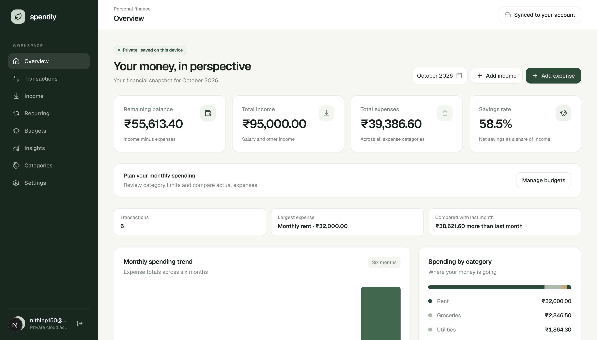

<div align="center">

# Spendly

### Your money, in perspective.

A private, browser-based finance app for tracking income, expenses, and spending patterns.

<a href="https://github.com/nithiin7/spendly"></a>


</div>

Spendly is a personal finance tracker built with Next.js, TypeScript, and Tailwind CSS. Manage transactions and categories, review monthly summaries and charts, and export your records as CSV. No account or server sync is configured.

## Pages

- **Overview (`/`)** — monthly balance, savings rate, spending breakdown, trends, and recent activity.
- **Transactions (`/transactions`)** — search, filter, sort, add, edit, delete, and export entries.
- **Income (`/income`)** — income transactions and monthly income history.
- **Recurring (`/recurring`)** — manage scheduled income and expense occurrences, and confirm or skip them.
- **Insights (`/insights`)** — month selection, comparisons, and spending analytics.
- **Categories (`/categories`)** — categories and automatic categorization rules.
- **Settings (`/settings`)** — local JSON backup and restore.

## Features

- 💸 Add, edit, delete, search, filter, sort, and export income and expense transactions.
- 🔁 Schedule recurring income and expenses; upcoming entries do not affect actual totals until confirmed, and skipped or confirmed occurrences remain in history.
- 🏷️ Organize transactions with custom categories and editable, rule-based suggestions.
- 📊 Review monthly income, expenses, balance, savings rate, category totals, and six-month spending trends.
- 🔒 Keep saved finance data in this browser using localStorage.
- 💾 Export a versioned JSON backup of categories, rules, transactions, and recurring history; preview and validate a backup before merging or replacing local data.
- ↩️ Clear saved data or restore the included sample data, with confirmation.

## Screenshot



## Technology

Next.js 16 · React 19 · TypeScript 5 · Tailwind CSS 4 · Lucide React

## Run locally

Requirements: Node.js 22.6.0 or newer and npm. The test script uses Node’s built-in TypeScript stripping.

```bash
npm ci
npm run dev
```

Open [http://localhost:3000](http://localhost:3000). To check the project, run `npm run lint`, `npm run typecheck`, `npm test`, and `npm run build`. GitHub Actions runs these checks on pushes and pull requests.

## Data and privacy

Spendly stores transaction, category, and rule data in the browser’s localStorage. The project does not configure an account, server-side storage, or synchronization. Browser storage is not encrypted or backed up by Spendly; anyone with access to your browser profile may be able to access it. CSV exports are downloaded to your device.

JSON backups are downloaded to your device and can be merged without overwriting existing records or explicitly used to replace all saved finance data. Backup files are validated locally before import; keep exported files private and secure.

See [Contributing](./CONTRIBUTING.md) for how to get involved and [LICENSE](./LICENSE) for the project’s license.
